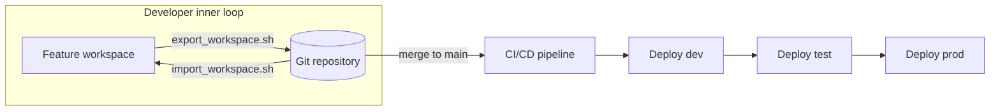

# Fabric CI/CD for Generic Git Providers

This sample implements a CI/CD workflow for Microsoft Fabric using the [Bulk Export and Import Item Definition APIs](https://learn.microsoft.com/en-us/fabric/cicd/tutorial-bulkapi-cicd) to promote Fabric item definitions from a Git repository into Fabric workspaces across multiple environments, with first-class support for service principal authentication and multi-tenant deployments.

## When to use this sample

Choose this sample when one or more of the following apply:

* Your organization promotes Fabric content through GitLab, Bitbucket, or another Git tool that Fabric Git integration does not natively support.
* Your environments (development, test, production) live in different Microsoft Entra tenants.

If your environments share a single tenant and you use a Fabric-supported Git provider, evaluate native [Fabric Git integration](https://learn.microsoft.com/fabric/cicd/git-integration/intro-to-git-integration) and [deployment pipelines](https://learn.microsoft.com/fabric/cicd/deployment-pipelines/intro-to-deployment-pipelines) first.

> [!TIP]
> This repository provides a GitLab CI/CD pipeline as the concrete example, but the approach is not GitLab-specific. The bash scripts and Bulk APIs work identically regardless of your Git provider. To adopt this pattern with GitHub Actions, Azure Pipelines, Bitbucket Pipelines, or any other CI system, replace `.gitlab-ci.yml` with the equivalent pipeline definition for your tool. The scripts themselves require no changes.

## How it works

The Bulk Export and Import APIs treat each item definition as code:

* Bulk export reads every supported item in a workspace and returns its definition parts in one asynchronous call.
* Bulk import writes a set of definition parts into a workspace in one asynchronous call, creating new items and updating existing ones.

Item identity travels in each item's `.platform` file as a logical ID. Fabric uses that logical ID to decide whether an incoming item is a create or an update, and it resolves dependencies between items automatically. There is no per-item object ID tracking and no manual ordering.

### Repository format

Items are stored in the native Fabric source format, the same layout Fabric Git integration produces:

```text
fabric/
├── SampleNotebook.Notebook/
│   ├── .platform
│   └── notebook-content.py
└── SampleDataPipeline.DataPipeline/
    ├── .platform
    └── pipeline-content.json
```

Each item lives in a `DisplayName.ItemType` folder. The `.platform` file carries the item type, display name, and logical ID. The remaining files are the item definition.

### Workflow



A developer iterates in a Fabric feature workspace, exports the workspace into the repository, and opens a merge request. When the change merges to `main`, the CI/CD pipeline imports the definitions into the dev workspace, then promotes them to test and production behind manual approval gates.

## Repository layout

| Path | Purpose |
|------|---------|
| `scripts/export_workspace.sh` | Export a workspace into the `fabric/` folder. |
| `scripts/import_workspace.sh` | Import the `fabric/` folder into a workspace. |
| `scripts/create_workspace.sh` | Create the target workspace and assign capacity. |
| `scripts/lib/` | Shared bash helpers for logging, auth, config, and API calls. |
| `config/*.env.example` | Per-environment configuration templates. |
| `fabric/` | Sample items in native Fabric source format. |
| `.gitlab-ci.yml` | Example CI/CD pipeline definition (GitLab). |
| `.github/workflows/quality.yml` | GitHub Actions checks for pull requests. |

## Prerequisites

* Bash, `curl`, and `jq` available on the runner and your local machine.
* A Fabric capacity that is running.
* A Microsoft Entra app registration (service principal) with a client secret, per environment.
* The service principal granted at least the Contributor role on each target workspace.
* The service principal must have access to any cloud connections referenced by Lakehouse shortcuts or data pipeline activities in the imported items. Grant the SPN at least **Read** permission on each connection via **Manage connections and gateways** in the Fabric portal.
* If shortcuts use connections authenticated with a **workspace identity**, the target workspace's identity must be granted the appropriate Azure RBAC role (for example Storage Blob Data Reader) on the source storage account. This is a manual step after workspace creation because each workspace has its own identity.
* The Fabric tenant setting **Service principals can use Fabric APIs** enabled by a Fabric administrator.
* (Only for `create_workspace.sh`) The service principal must be a **capacity contributor** (or capacity admin) on the target capacity, and the tenant setting **Create workspaces** must include the SPN or its security group. If the SPN does not have these elevated permissions, pre-create the workspaces manually and the import/export scripts will work with just workspace Contributor.

## Setup

### 1. Clone the repository

Fork or clone this repository. This gives you the scripts, config templates, sample items, and CI pipeline definition locally.

```bash
git clone <your-fork-url>
cd fabric-cicd-generic-git
```

### 2. Configure environments

Copy the appropriate template and fill in real values. The resulting `config/*.env` files are gitignored.

```bash
# For service principal mode (CI/CD and local dev with SPN access):
cp config/dev.env.example config/dev.env

# For Azure CLI user-token mode (local dev without SPN access):
cp config/dev-user.env.example config/dev-user.env
```

Each file sets the tenant and workspace name for one environment. SPN configs additionally include client ID, client secret, and capacity. See step 3 for which mode to choose.

### 3. Authenticate

The scripts support two authentication modes, auto-detected based on which environment variables are set:

| Mode | When used | Requires |
|------|-----------|----------|
| **Service principal** | `FABRIC_CLIENT_SECRET` is set | `FABRIC_TENANT_ID`, `FABRIC_CLIENT_ID`, `FABRIC_CLIENT_SECRET` |
| **Azure CLI (user token)** | `FABRIC_CLIENT_SECRET` is NOT set, or `FABRIC_AUTH_MODE=azcli` | `FABRIC_TENANT_ID`, `az login` session |

**Service principal mode** (recommended for CI/CD): Uses the OAuth2 client-credentials flow. Set up a `config/<env>.env` with all three SPN variables. This is the default for pipeline runners.

**Azure CLI mode** (for local dev when you cannot create an SPN): Uses `az account get-access-token` to get a delegated user token from your existing `az login` session. Set up a `config/<env>.env` with `FABRIC_AUTH_MODE=azcli`, `FABRIC_TENANT_ID`, and `FABRIC_WORKSPACE_NAME` (see `config/dev-user.env.example`).

> [!TIP]
> If your shell environment already has `FABRIC_CLIENT_SECRET` set (for example from a parent session), adding `FABRIC_AUTH_MODE=azcli` to your config file explicitly forces Azure CLI auth and clears the inherited SPN variables.

To use Azure CLI mode:

```bash
cp config/dev-user.env.example config/dev-user.env
# Edit with your tenant ID and workspace name

source config/dev-user.env

az login --tenant $FABRIC_TENANT_ID --use-device-code
scripts/import_workspace.sh --env dev-user --source fabric
```

> [!NOTE]
> Azure CLI tokens expire after ~1 hour. If a long operation fails with a 401, run `az login` again.

For CI/CD pipelines, always use service principal mode.

If you cannot create an app registration yourself (many tenants restrict this), request a dev or sandbox service principal from your Fabric or Entra administrator. Ask for a client ID and secret plus Contributor access on the dev workspace.

### 4. (Optional) Create the target workspace

Skip this step if you don't need to create a new workspace.

If the target workspace does not already exist, create it with:

```bash
scripts/create_workspace.sh --env dev
```

This creates the workspace named in `config/dev.env` and assigns it to the configured capacity. If the workspace already exists, the script exits without changes.

To also grant a developer Admin access to the new workspace, pass their Entra object ID:

```bash
scripts/create_workspace.sh --env dev --admin "00000000-0000-0000-0000-000000000000"
```

You can find a user's object ID in the Azure portal under **Microsoft Entra ID > Users > (select user) > Object ID**.

### 5. Run locally

> [!WARNING]
> If your **source** workspace contains Fabric items using connections authenticated with a **workspace identity**, grant the **target** workspace's identity the appropriate Azure RBAC role (for example Storage Blob Data Reader for storage accounts) on the underlying data source before running the export. This is a one-time manual step per workspace.

```bash
chmod +x scripts/*.sh
scripts/import_workspace.sh --env dev --source fabric --dry-run   # validate payload
scripts/import_workspace.sh --env dev --source fabric             # deploy
scripts/export_workspace.sh --env dev --output fabric --prune     # capture changes
```

### 6. Configure CI/CD (GitLab example)

The included `.gitlab-ci.yml` is a validated reference implementation. Adapt it to your CI system as needed.

Create environment-scoped CI/CD variables (Settings > CI/CD > Variables) for each GitLab Environment (`dev`, `test`, `prod`):

| Variable | Notes |
|----------|-------|
| `FABRIC_TENANT_ID` | Service principal tenant ID. |
| `FABRIC_CLIENT_ID` | Service principal client ID. |
| `FABRIC_CLIENT_SECRET` | Service principal client secret. Mark masked and protected. |
| `FABRIC_WORKSPACE_NAME` | Target workspace display name. |

The pipeline reads these variables directly, so no `config/*.env` file is needed in CI. Its `validate` stage runs ShellCheck and a dry run; `deploy:dev` runs on `main`; `deploy:test` and `deploy:prod` run behind manual gates. GitHub Actions separately runs ShellCheck, Markdown linting, YAML linting, and link checks on pull requests.

#### Troubleshooting CI/CD

* **`deploy` job falls through to Azure CLI auth** — The `FABRIC_CLIENT_SECRET` variable is likely marked **Protected** but the branch is not protected. GitLab only injects protected variables into pipelines running on protected branches. Either uncheck "Protect variable" or protect the `main` branch under Settings > Repository > Protected branches.

## Scripts

### export_workspace.sh

```text
scripts/export_workspace.sh --env <name> [--output <dir>] [--mode All|Selective] [--items <guids>] [--prune]
```

Exports all (or selected) item definitions from a Fabric workspace into a local folder. The script performs these steps:

1. Authenticates with the service principal configured in `config/<name>.env`.
2. Resolves the workspace display name to a workspace ID via the List Workspaces API.
3. Calls the Bulk Export API (`POST /v1/workspaces/{id}/items/bulkExportDefinitions`) with mode `All` or `Selective`.
4. Polls the long-running operation until completion.
5. Iterates over each entry in the `definitionParts[]` array of the result. Each entry contains a `path` (for example `/SampleNotebook.Notebook/.platform`) and a base64-encoded `payload`. The script decodes the payload and writes it to the corresponding file path under the output folder.
6. If `--prune` is set, deletes any local files in the output folder that were not present in the export result, then removes empty directories. This keeps the local tree in sync when items are renamed or deleted from the workspace.

| Option | Description |
|--------|-------------|
| `--env <name>` | Environment config to load (required) |
| `--output <dir>` | Destination folder (default: `fabric/` at repo root) |
| `--mode All\|Selective` | Export all supported items or only specific ones (default: `All`) |
| `--items <guids>` | Comma-separated item GUIDs for Selective mode |
| `--prune` | Remove local files not returned by the export |

### import_workspace.sh

```text
scripts/import_workspace.sh --env <name> [--source <dir>] [--allow-pairing-by-name] [--dry-run]
```

Imports item definitions from a local folder into a Fabric workspace. The script performs these steps:

1. Authenticates with the service principal configured in `config/<name>.env`.
2. Resolves the workspace display name to a workspace ID.
3. Walks the source folder recursively. For each file, it constructs a definition part with the relative path prefixed by `/` (matching the API format) and base64-encodes the file content as the payload.
4. Assembles all parts into a single JSON request body with a `definitionParts[]` array.
5. Calls the Bulk Import API (`POST /v1/workspaces/{id}/items/bulkImportDefinitions`).
6. Polls the long-running operation until completion.
7. Reads `importItemDefinitionsDetails[]` from the result and prints a per-item summary showing the display name, item type, operation (Create or Update), and status (Succeeded or Failed). Exits non-zero if any item failed.

| Option | Description |
|--------|-------------|
| `--env <name>` | Environment config to load (required) |
| `--source <dir>` | Source folder containing item definitions (default: `fabric/`) |
| `--allow-pairing-by-name` | Match items by display name and type when logical IDs differ |
| `--dry-run` | Build and validate the JSON payload without calling the API |

In `--dry-run` mode, the script prints the total number of definition parts and their paths, then exits. No authentication or network call is performed.

> [!IMPORTANT]
> The `--allow-pairing-by-name` option only works when the target workspace item has **no logical ID** (for example, items created manually through the Fabric portal). If an item was previously deployed via Bulk Import or Git sync, Fabric assigns it a logical ID. Subsequent imports with a different logical ID will fail with `DuplicateDisplayNameAndType` even with pairing enabled, because Fabric treats the existing logical ID as authoritative.

### create_workspace.sh

```text
scripts/create_workspace.sh --env <name> [--admin <user-object-id>]
```

Creates the target workspace and assigns it to the configured capacity. If the workspace already exists, the script prints its ID and exits without changes.

1. Authenticates with the service principal.
2. Calls List Workspaces to check whether the workspace name already exists.
3. If not found, calls `POST /v1/workspaces` with the display name and optional capacity ID from the config.
4. If `--admin` is provided, calls `POST /v1/workspaces/{id}/roleAssignments` to add the specified Entra object ID as a workspace Admin.

| Option | Description |
|--------|-------------|
| `--env <name>` | Environment config to load (required) |
| `--admin <id>` | Entra object ID of a user or group to add as workspace Admin |

## Known limitations

* Service principal support depends on item type. The export and import operations succeed only when every item involved supports service principal operations.
* Items that hard-reference another item by workspace or item GUID (for example a pipeline that invokes a specific notebook by ID) need rebinding per environment. The sample keeps items independent to avoid this; parameterize such references when you add them.
* Sensitivity labels are enforced by Fabric. Items with protected labels may not export or import.

## Related resources

* [Introducing Bulk Export and Import APIs for CI/CD in Microsoft Fabric](https://community.fabric.microsoft.com/t5/Fabric-Updates-Blog/Introducing-Bulk-Export-and-Import-APIs-for-CI-CD-in-Microsoft/ba-p/5172183)
* [Bulk Export Item Definitions API reference](https://learn.microsoft.com/rest/api/fabric/core/items/bulk-export-item-definitions)
* [Bulk Import Item Definitions API reference](https://learn.microsoft.com/rest/api/fabric/core/items/bulk-import-item-definitions)
* [Tutorial: CI/CD using the Bulk Import and Export API](https://learn.microsoft.com/en-us/fabric/cicd/tutorial-bulkapi-cicd)
